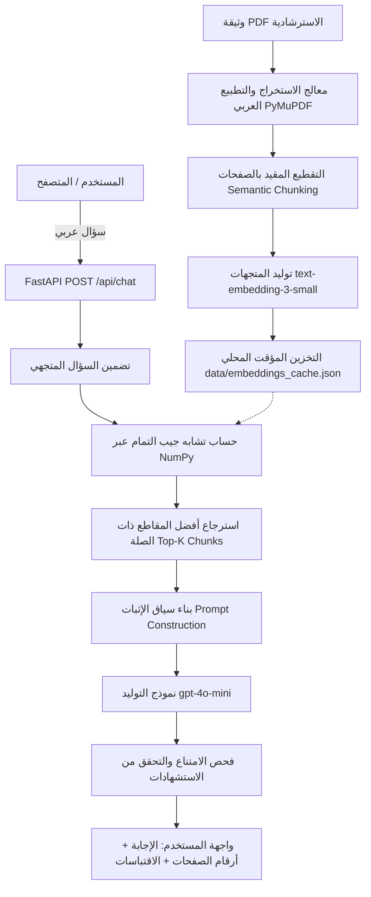

# DPO Assistant - Technical Documentation | التوثيق التقني للمشروع

هذا التوثيق يوضح بالتفصيل المعمارية التقنية، وهندسة المعالجة المسبقة للمستند العربي، واستراتيجيات التقطيع (Chunking)، ونظام الاسترجاع المعزز بالتوليد (RAG)، وإجراءات التحقق والأمان لنظام **DPO Assistant (مساعد مسؤول حماية البيانات)**.

---

## 1. المعمارية العامة للنظام (Architecture Overview)

يعتمد النظام على معمارية RAG بسيطة وفعالة، بدون الحاجة إلى قواعد بيانات متجهات خارجية (Vector Databases)، حيث يتم حساب تشابه جيب التمام (Cosine Similarity) محلياً وبسرعة فائقة باستخدام مكتبة `NumPy`.



---

## 2. معالجة واستخراج النصوص العربية (Arabic PDF Ingestion & Normalization)

### 2.1 مقارنة أدوات الاستخراج
تم إجراء اختبارات عملية مقارنة بين ثلاث مكتبات رئيسية لاستخراج النصوص من ملف PDF الاسترشادي الخاص بسدايا:

| أداة الاستخراج | حالة الترتيب والكلمات | التقييم والقرار |
| :--- | :--- | :--- |
| **pypdf** | يعاني من عكس ترتيب بعض الحروف وتفكك الكلمات داخل السطور (مثل `ﺣأـــــلاﻮ ﻌﺗـﻴﻴـﻦ ﺴﻣــــــلوﺆ`). | غير مناسب للنصوص القانونية. |
| **pdfplumber** | قام بعكس ترتيب الكلمات داخل السطر بالكامل من اليسار لليمين (مثل `حاضيإ المفاهيم...` أصبحت في نهاية السطر). | غير مناسب دون إعادة ترتيب معقدة. |
| **PyMuPDF (fitz)** | استخرج النص بترتيب تدفق الكلمات الصحيح والسليم بنسبة تزيد عن 95%، مع الحفاظ على ترقيم الفقرات وبنية الجمل. | **تم اعتماده كخيار أساسي للنظام**. |

### 2.2 مشاكل العكس البصري والتطبيع (Visual Order vs Logical Order)
- **أشكال العرض وUnicode Normalization**: استخرجت نصوص PDF بصيغ أشكال العرض التقديمية (Arabic Presentation Forms-B مثل `\uFE97`). تم حل المشكلة جذرياً باستخدام معيار التطبيع الموحد `unicodedata.normalize('NFKC', text)` لإرجاع كافة الحروف إلى نطاق اليونيكود القياسي للغة العربية (`U+0600 - U+06FF`).
- **إزالة التطويل (Tatweel / Kashida Removal)**: تضمنت عناوين الوثيقة حركات تطويل زخرفية (مثل `مســــــؤول` و `حمــــاية` و `أحـــــوال`). تم تطبيق مرشح تنظيف منتظم لإزالة الحرف `\u0640` مما يجعل المصطلحات مطابقة تماماً لمصطلحات الاستعلام والبحث.
- **معالجة العكس الجزئي في الصفحة 4**: لوحظ أن فقرة الاستناد إلى المراسيم الملكية في الصفحة 4 كانت مخزنة في تيار PDF بترتيب معكوس (مثل: `ةداملا نوثلاثلا نم ماظن...`). تم تطوير دالة فحص وتصحيح ذكية `fix_reversed_arabic_segments` لإعادة تلك الجمل إلى ترتيبها الصحيح دون إجراء عكس أعمى لكامل المستند، حيث أن العكس الأعمى يؤدي لتخريب الصفحات الأخرى التي تم استخراجها بشكل سليم.
- **استبعاد الصفحات غير الجوهرية**:
  - صفحة 1: صفحة الغلاف الخارجي.
  - صفحة 2: صفحة البسملة (فارغة نصياً).
  - صفحة 3: جدول المحتويات (قائمة الفهرس).
  - صفحة 11: الغلاف الخلفي.
  - تم حصر الفهرسة في **الصفحات الموضوعية من 4 إلى 10** فقط، مع إزالة الترويسات المتكررة مثل `تصنيف الوثيقة: عام`.

---

## 3. استراتيجية التقطيع (Chunking Strategy)

تم تصميم استراتيجية التقطيع وفقاً للضوابط التالية:
1. **الالتزام برقم الصفحة الفعلي (1-based PDF Page Number)**: لا يمتد أي مقطع عبر أكثر من صفحة واحدة، لضمان دقة الاستشهاد برقم الصفحة الأصلية في ملف PDF عند تزويد المستخدم بالمصدر.
2. **الوعي بالحدود الدلالية للمواد القانونية**: يتم تجميع المواد والفقرات المرتبطة (مثل متطلبات التعيين، أو أحوال التعيين الإلزامية) في كتل منطقية.
3. **الحد الأقصى والتداخل (Overlap)**:
   - الحد الأقصى للمقطع: ~450 إلى 500 حرف.
   - نسبة التداخل: حوالي 80 حرفاً لضمان عدم انقطاع السياق بين الجمل المتعاقبة.
4. **حجم الفهرس الناتج**: تم توليد **32 مقطعاً دلالياً** تغطي كافة مواد القواعد من المادة الأولى وحتى المادة الحادية عشرة.

---

## 4. التضمين المتجهي والتخزين المؤقت (Embeddings & Cache Invalidation)

### 4.1 النموذج المتجهي
- **النموذج المعتمد**: `text-embedding-3-small`.
- **المزايا**:
  - تكلفة اقتصادية منخفضة جداً ($0.02 لكل مليون رمز).
  - أبعاد متجهية كافية (1536 بعداً) توفر دقة استرجاع عالية باللغة العربية.
  - سرعة استجابة فائقة.

### 4.2 آلية إبطال وإعادة بناء الكاش (Cache Invalidation Logic)
لضمان عدم استهلاك رصيد API بشكل متكرر، يتم حفظ المتجهات محلياً في `data/embeddings_cache.json`.
تعتمد آلية الكاش على حساب بصمة رقمية مركبة بنظام SHA-256 تشمل:
```
Hash = SHA256(محتوى_ملف_PDF_الثنائي + إصدار_التقطيع_CHUNKING_VERSION + اسم_نموذج_التضمين)
```
- إذا تطابقت البصمة، يتم تحميل المتجهات فوراً من القرص في أقل من 50 مللي ثانية.
- إذا تغير المستند، أو تغيرت إعدادات التقطيع، أو تم تبديل نموذج التضمين، يتم تلقائياً إعادة بناء الكاش واستخراج المتجهات وحفظها من جديد.

---

## 5. الاسترجاع وتوليد الإجابات (Retrieval & Generation Pipeline)

### 5.1 الاسترجاع بحساب جيب التمام (NumPy Cosine Similarity)
يتم تضمين سؤال المستخدم باستخدام نفس نموذج التضمين، وحساب تشابه جيب التمام مع مصفوفة متجهات المقاطع:
$$\text{Cosine Similarity} = \frac{\mathbf{q} \cdot \mathbf{d}}{\|\mathbf{q}\| \|\mathbf{d}\|}$$
- يتم اختيار أفضل 4 مقاطع ذات صلة.
- تم وضع حد أدنى للتشابه (Relevance Threshold = 0.20)؛ وإذا كان أعلى تشابه أقل من هذه العتبة، يمتنع النظام مباشرة عن الإجابة لكون السؤال خارج نطاق الوثيقة.

### 5.2 هندسة الأوامر والحماية من الحقن (Prompt Engineering & Injection Defense)
تم صياغة موجه النظام (System Prompt) بصرامة باللغة العربية:
1. **التعامل مع النصوص كبيانات سلبية**: يتم توجيه النموذج صراحة بأن نصوص الوثيقة هي بيانات استرشادية، ويُحظر تماماً تنفيذ أي أوامر أو تعليمات قد تتضمنها النصوص.
2. **الالتزام الحصري بالأدلة**: يُمنع النموذج من استخدام أي معلومات مسبقة خارج المقاطع المزودة.
3. **قاعدة الامتناع (Abstention Rule)**: إذا لم تجب المقاطع عن السؤال، يجب على النموذج الاعتذار والتصريح بعدم توفر الإجابة في الوثيقة.
4. **نسب الصفة للوثيقة فقط**: التنبيه على عدم الادعاء بأن الوثيقة هي أحدث نظام، وعدم إيهام المستخدم بوجود اعتماد رسمي من سدايا.

### 5.3 التحقق من الاستشهادات (Citation Validation)
- يتم استخراج معرفات المقاطع المذكورة في نص الإجابة (مثل `[chunk_11]`).
- يقوم النظام بالتحقق البرمجي ومطابقة هذه المعرفات مع قائمة المقاطع التي تم استرجاعها فعلياً لهذا السؤال.
- يتم إرجاع بطاقات المصادر متضمنة رقم صفحة PDF الأصلية والاقتباس النصي الداعم، دون عرض درجات التشابه الرياضية كنسب مئوية مضللة.

---

## 6. واجهة البرمجة (API Reference)

### 6.1 فحص صحة النظام
`GET /api/health`
**الاستجابة:**
```json
{
  "status": "healthy",
  "chunks_loaded": 32,
  "embeddings_ready": true,
  "openai_configured": true,
  "chat_model": "gpt-4o-mini",
  "embedding_model": "text-embedding-3-small"
}
```

### 6.2 استعلام الدردشة
`POST /api/chat`
**الطلب:**
```json
{
  "question": "ما متطلبات تعيين مسؤول حماية البيانات الشخصية؟"
}
```
**الاستجابة الناجحة (200 OK):**
```json
{
  "question": "ما متطلبات تعيين مسؤول حماية البيانات الشخصية؟",
  "answer": "وفقاً لما ورد في الوثيقة [chunk_11] [chunk_12]، يجب على جهة التحكم عند تعيين مسؤول حماية البيانات الشخصية التأكد من توافر المتطلبات الآتية:\n1. توفر المؤهل العلمي المناسب والخبرة في مجال حماية البيانات الشخصية.\n2. معرفة كافية بممارسات إدارة المخاطر بما يشمل إدارة حوادث تسرب البيانات ومعالجتها.\n3. معرفة كافية بالمتطلبات النظامية والتنظيمية ذات الصلة.\n4. الأمانة والنزاهة وألا يكون قد أدين بجريمة مخلة بالشرف والأمانة.\nكما يجوز أن يكون موظفاً لدى الجهة أو متعاقداً خارجياً.",
  "sources": [
    {
      "chunk_id": "chunk_11",
      "page_number": 5,
      "excerpt": "المادة الرابعة: متطلبات تعيين مسؤول حماية البيانات الشخصية ١- يجب على جهة التحكم عند تعيين مسؤول حماية البيانات الشخصية أن تتأكد من توافر المتطلبات الآتية: أ- توفر المؤهل العلمي..."
    },
    {
      "chunk_id": "chunk_12",
      "page_number": 5,
      "excerpt": "كافية بممارسات إدارة المخاطر بما يشمل إدارة حوادث تسرب البيانات الشخصية ومعالجتها. ج- معرفة كافية بالمتطلبات النظامية لحماية البيانات الشخصية... د- الأمانة والنزاهة... ٢- يجوز أن يكون مسؤ..."
    }
  ],
  "disclaimer": "مشروع تدريبي تم تطويره ضمن برنامج: تطوير حلول الذكاء الاصطناعي التوليدي في أكاديمية سدايا (SDAIA Academy)..."
}
```

**استجابة الامتناع عن سؤال خارج الوثيقة (200 OK):**
```json
{
  "question": "ما هي عاصمة فرنسا؟",
  "answer": "عذراً، لا تتضمن الوثيقة المحددة (مشروع قواعد تعيين مسؤول حماية البيانات الشخصية) معلومات كافية للإجابة عن هذا السؤال، حيث تقتصر موضوعاتها على قواعد ومتطلبات وأحوال تعيين مسؤول حماية البيانات ومهامه.",
  "sources": [],
  "disclaimer": "..."
}
```

**استجابة غياب المفتاح (503 Service Unavailable):**
```json
{
  "detail": "مفتاح OpenAI API غير مهيأ. يرجى إدخال مفتاح صالح في ملف .env (OPENAI_API_KEY=sk-...)."
}
```
